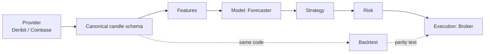

# Architecture

_Last reviewed: 2026-10-22. Update this file whenever a module contract or the data flow changes._

## Data flow

## Build order and why

`config → data → features → models → strategy → risk → backtest → execution → engine`.
Each module depends only on the ones before it, so it can be tested in isolation; `engine` is last because it only wires finished parts together.

## Contracts

| Contract | Location | Rule |
|---|---|---|
| Candle schema | `mlt/data/schema.py` | UTC close-time index, sorted, unique, finite positive prices; gaps are reported, never filled silently. Venue-specific columns must never be used by a deployed model. |
| `CandleProvider` | `mlt/data/providers/base.py` | Returns validated candles in the canonical schema. |
| `Forecaster` | `mlt/models/base.py` | `predict` required; `fit` / `partial_fit` optional; `get_state` / `set_state` so live resumes instead of retraining. Model-agnostic on purpose, so every family competes fairly. |
| `simulate` / `metrics` | `mlt/evaluation.py` | A position decided at the close of bar *t* is held over bar *t+1*; costs are charged on position changes; funding is charged per held hour (sign and timing assumed, shown with sensitivity). The backtest module must reproduce these conventions. |
| Evaluation protocol | `mlt/protocol.py` | Frozen data end and three time blocks on candle close time; the test block can be read only with `allow_test=True` (once, for the final candidate); batch training purges `horizon` rows before a block. |
| `run_online` | `mlt/models/online.py` | Causal walk-forward: at step *i* update with the sample that matured at *i* (row *i − horizon*), then predict row *i*. |
| Settings | `mlt/config.py` | Dry-run unless both `DRY_RUN=false` and the confirmation phrase are set. |

## Principles

- **Parity**: one input window gives one prediction in notebook, backtest and live.
- **Causality**: only closed candles; features at bar *t* never see data after *t*.
- **Helpers built during research**: `evaluation`, `models.linear` and `models.online` exist because notebook 02 needs them; each has unit tests. Feature and strategy code stays in the notebooks until the research gate is passed.
- **Evidence before code**: modules are built only after the research gate (see README §2).
